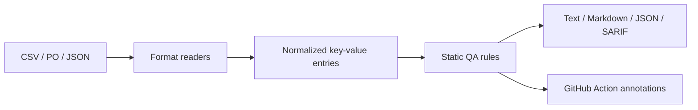

# GameText Gate

Offline localization QA for game text exports. Compare a source locale with a target locale, catch missing and extra keys, empty translations, duplicate keys, and placeholder or supported markup mismatches. It never translates or rewrites input files.

**Python 3.10+ · no runtime dependencies · local files only · MIT**

## Supported inputs

| Input | Supported shape | Notes |
|---|---|---|
| Unity Localization CSV | Exported table with a `Key` column and locale columns such as `Text (en)` / `Text (fr)` | Select locale with `--source-locale` / `--target-locale`; custom layouts can pass column options. |
| Godot CSV | `keys` plus a selected locale/value column | Pass `--source-column` and `--target-column` for `keys,values` exports. |
| Gettext PO | `msgid`, `msgctxt`, `msgstr`, multiline quoted strings, plural `msgstr[n]` | Plural forms are joined for token checks. Context is combined with `msgid` for key identity. |
| Nested JSON | String leaves in objects/arrays | Flattened to escaped JSON Pointer keys. Duplicate object keys are rejected. |

Placeholder checks cover simple `{name}` / `{0}`, printf-style tokens, a conservative Unity-style rich-text tag allowlist, and a conservative BBCode tag allowlist. ICU plural/select and typed ICU expressions are explicitly reported as unsupported notes; this tool does not claim full ICU, HTML, BBCode, or engine-runtime validation. Findings are static checks and require human review.

Inputs are read as UTF-8 (optional BOM), with a default 10 MiB per-file and 100,000-entry limit. Nothing is uploaded. Reports contain file paths and localization keys for navigation; source or translated text is not copied into reports.

## Install and run

```powershell
python -m pip install .
game-text-gate --source locales/en.csv --target locales/ru.csv --source-locale en --target-locale ru --report markdown --output localization-report.md
```

Unity CSV with explicit columns:

```powershell
game-text-gate --source en.csv --target fr.csv --source-locale en --target-locale fr --source-column "Text (en)" --target-column "Text (fr)"
```

Godot CSV:

```powershell
game-text-gate --source en.csv --target ru.csv --format csv --source-column values --target-column values --report json --output report.json
```

PO and JSON formats are inferred from `.po` and `.json`. Use `--report text|markdown|json|sarif`, `--fail-on error|warning`, `--max-file-size`, and `--max-entries`. Exit codes: `0` clean or below the selected threshold, `1` findings at/above threshold, `2` invalid input or invocation.

## GitHub Action

The action runs the checked-out source directly. In a consuming workflow, check out the game repository before invoking it. The action does not install the game repository as a Python package.

```yaml
name: Localization QA
on: [pull_request, push]
permissions:
  contents: read
jobs:
  localization:
    runs-on: ubuntu-latest
    steps:
      - uses: actions/checkout@v4
      - uses: GhosTnever-lkm/game-text-gate@v0.1.3
        with:
          source: Localization/en.csv
          target: Localization/ru.csv
          source-locale: en
          target-locale: ru
          report: markdown
          report-path: localization-report.md
          fail-on: error
          python-version: '3.12'
```

For SARIF upload, set job `security-events: write`, ask the action for `report: sarif`, then use GitHub's `upload-sarif` action with the generated file. The action itself does not request write permissions or upload artifacts.

## Architecture



All analysis runs locally in the CLI or in the GitHub Actions runner. The tool does not upload localization files or perform translations.

## Support / Pro Version

The free CLI and GitHub Action are MIT-licensed. Optional Pro add-ons provide extra reporting workflows while reusing the free core. The [Locale Matrix Pro add-on](https://boosty.to/azizazimov/posts/PRO_POST_ID) compares several target locales in one run and creates a filterable local HTML report.

Support: [Boosty](https://boosty.to/azizazimov). No paid purchase is needed to use the free tool.

## Local development

```powershell
$env:PYTHONPATH = "src"
python -m unittest discover -s tests -v
python -m compileall -q src tests
```

## License

MIT. See [LICENSE](LICENSE).
